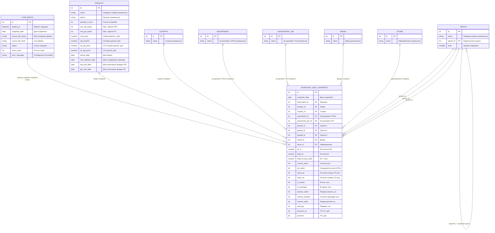

## ER-диаграмма данных (Kimball)

**Kimball** — это подход к построению хранилищ данных и BI-систем с акцентом не на “идеально централизованной” модели, а на понятных бизнесу витринах данных, собранных вокруг процессов и измерений. Его главная идея: сначала проектировать аналитику от нужд бизнеса, а уже потом подбирать структуру данных под эти задачи.

**Суть подхода:**
Методология Кимбалла строится вокруг dimensional modeling — размерной модели данных. В такой модели есть фактовые таблицы, где лежат измеряемые события, и таблицы-измерения, которые описывают контекст этих событий.

**Из чего состоит:**
Классическая архитектура по Кимбаллу обычно включает:

- staging area — зона первичной загрузки;
- ETL/ELT-процессы;
- фактовые таблицы;
- таблицы измерений;
- витрины данных для отдельных направлений бизнеса.

**Kimball vs Inmon**
- Kimball — начинаем с витрин и размерной модели, быстро даем пользу бизнесу.
- Inmon — начинаем с централизованного корпоративного хранилища, а витрины строим позже

